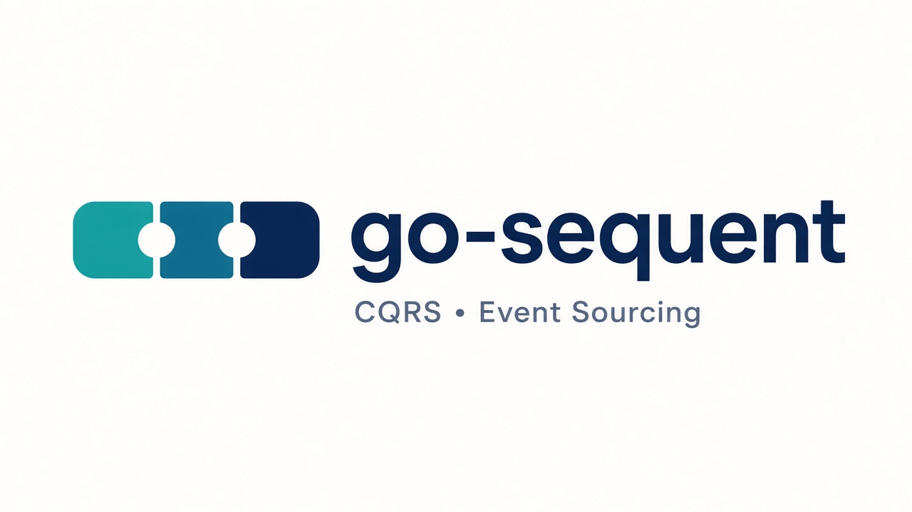

# go-sequent

<p align="center">
  
</p>

Go CQRS + Event Sourcing library for financial systems, inspired by [Sequent](https://sequent.io/) (conceptual only — no Ruby DB compatibility).

Brand assets: [docs/brand/](docs/brand/).

**Status:** Phase 4 (production hardening). Private / not open-source.

## Module

```text
github.com/go-sequent/go-sequent
```

## Docs

- [docs/guide.md](docs/guide.md) · [zh](docs/guide.zh.md) — **framework reference** (Sequent-inspired concepts, implemented APIs; OpenTelemetry / `obs` in §19)
- [docs/getting-started.md](docs/getting-started.md) · [zh](docs/getting-started.zh.md)
- [docs/ci.md](docs/ci.md) · [zh](docs/ci.zh.md) — GitHub Actions CI/CD (private repo; tag releases for CLI)
- [docs/design.md](docs/design.md)
- [docs/ops/](docs/ops/) — failover, rebuild, backup, partitioning
- [docs/security/](docs/security/) — threat model, event evolution
- [docs/bench.md](docs/bench.md) — load / conflict benchmarks

## Test & bench

```bash
go test./...
go test./bench/ -bench=. -benchmem
GO_SEQUENT_PG_DSN='postgres://…' go test./bench/ -bench=BenchmarkPostgres -benchmem
```

## Ops CLI

```bash
go run./cmd/go-sequent migrate -dsn "$GO_SEQUENT_PG_DSN"
go run./cmd/go-sequent outbox -dsn "$DSN" -once
```

Ledger projectors remain **SyncInTxn**. Hash chain yes; **no** event signatures. Never import Ruby Sequent DBs.
